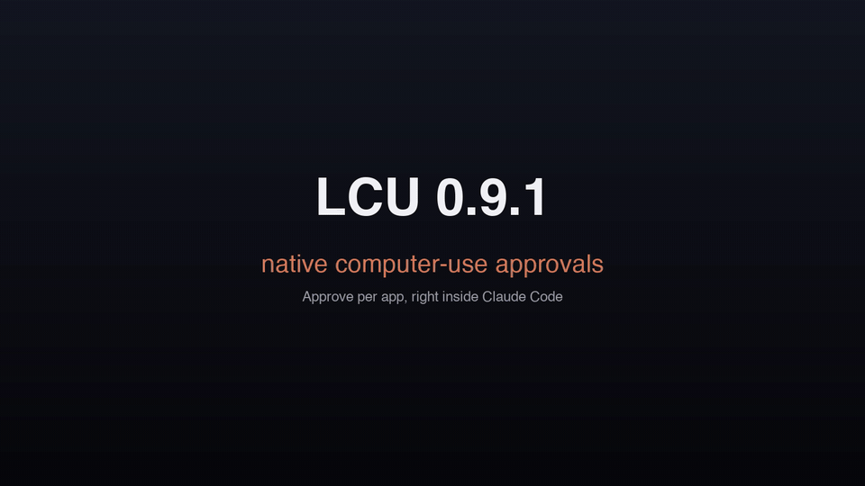

<p align="center">
  
</p>

<h1 align="center">LCU 中文版（lcu-zh）</h1>

<p align="center"><strong>Codex 的 Computer Use，从 Codex 应用中解耦出来。</strong></p>

<p align="center">
  <a href="https://github.com/amontlabs/lcu">上游 amontlabs/lcu</a> ·
  <a href="docs/INSTALLATION.md">安装指南（中文）</a> ·
  <a href="docs/ADAPTERS.md">Harness 适配器（中文）</a>
</p>

> **这是什么**：本仓库是 [amontlabs/lcu](https://github.com/amontlabs/lcu) 的非官方简体中文汉化版。LCU 把 Codex 原版的 Computer Use 运行时暴露给你的 Agent，而不需要 Codex 认证。官方 ChatGPT 桌面应用仍需安装在本地——它提供运行时与指令，LCU 负责安装与 harness 集成。
>
> **翻译范围**：README、安装指南与适配器文档为中文翻译；代码注释、其余 20+ 篇工程文档（`docs/` 下）与测试保持英文原文，请对照[上游仓库](https://github.com/amontlabs/lcu)阅读。安装脚本与命令一律使用原文，保证与上游一致可直接执行。
>
> **同步基线**：上游 v0.11.4（commit 4028296）。许可证 MIT（见 [LICENSE](LICENSE)），版权归 Amont Labs，汉化 by [@bayshier](https://github.com/bayshier)。

## 快速开始

把下面这段话丢给你的 Agent：

```text
Install and configure LCU for this harness using the latest release.
Follow https://raw.githubusercontent.com/amontlabs/lcu/main/docs/INSTALLATION.md
Check my OS, architecture, and prerequisites, then guide me through any required permissions.
```

在 Apple Silicon Mac 的 Claude Code 里，两条命令通过插件市场完成安装，见 [Claude Code 插件](docs/INSTALLATION.md#claude-code-插件)：

```sh
claude plugin marketplace add amontlabs/lcu
claude plugin install lcu@lcu
```

## 功能

- **桌面应用**：读取窗口、点击、输入、截屏。
- **Chrome（可选开启）**：通过官方扩展读取并控制标签页，带站点审批。
- **接入你的 Harness**：Pi、Codex CLI 与 Claude Code 提供适配器，另有实验性的 Oh My Pi 与 Hermes 集成。行为细节与验证边界见[适配器文档](docs/ADAPTERS.md)。

## 在 Claude 里原生批准应用

Agent 第一次控制某个应用（Zed、Notes、Safari）时，Computer Use 运行时会请求你放行。Claude 应用的 Code 标签页过去会让这一步失败，报「Computer Use was not approved」。`lcu setup --agent claude-code` 现在会安装一个小型 Claude Code 模组 `lcu-approve`，把这个问题原生地问出来：在 Claude 应用里是一张问题卡片（会把会话标记为需要输入），在终端里则是一个 **Computer use 审批**面板。

<p align="center"></p>

- **允许本次会话**：只在当前对话生效。
- **总是允许**：记住该应用（仅在运行时允许时提供）。
- **拒绝**：拒绝请求。

`/computer-use-apps` 命令会在同一处打开**已批准应用**面板：每个始终允许的应用一行，带撤销按钮（macOS 会要求触控 ID 或密码）；不再安装的应用单独分组；还有本会话的授权与一个允许输入框。

只有你能回答：模型看不到、按不到、也伪造不了这个面板。高危应用会显示运行时自带的警告（措辞改为「computer use」与「the agent」），而承载 Agent 的应用本身永远不会被批准。需要 Claude 应用或 Claude Code 2.1.287+。[工作原理](docs/ADAPTERS.md)、[如何移除](docs/INSTALLATION.md#卸载)。

在 Claude 应用中，请通过 Claude Code 注册 LCU（`lcu setup --agent claude-code`），不要走 Settings > Connectors；见[安装文档](docs/INSTALLATION.md)。

## 用触控 ID 管理已批准的应用

「总是允许」会被记住。在终端（macOS）里随时复查与修改这份清单，不需要打开 Codex 应用：

```sh
lcu apps                 # 今天都常驻允许了哪些应用
lcu apps allow Zed       # 触控 ID（或密码）之后，Zed 被允许
lcu apps revoke Zed      # 收回授权
```

<p align="center"></p>

- 可以传应用名、bundle 标识符或 `.app` 路径。
- 列表操作免费；`allow` 与 `revoke` 需要你在机器前——正在运行的 Agent 执行这两条时会被提示拦停。
- 运行中的会话会立即感知变更。
- 浏览器、密码管理器等高危应用自带警告；Computer Use 直接拒绝的应用（Terminal、iTerm2）也会被拒。

[细节](docs/INSTALLATION.md)。

## 跨回合保留 Computer Use（Claude Code）

在 Claude Code 里，Computer Use 通常随着发起它的那个回合结束而结束。回合结束后仍在工作的后台子 Agent，或复用已结束回合 ID 的回合，会被告知「Computer Use is unavailable because the current turn ended.」一个可选设置能让它在整个会话的每个回合都可用：

```sh
lcu cross-turn           # 查看状态
lcu cross-turn on        # macOS 上需要触控 ID（或密码）
lcu cross-turn off       # 关闭提示
```

- 默认关闭。`lcu setup --cross-turn on|off` 也能设置；交互式安装会问一次。
- 只影响 Claude Code 中继；Codex、Pi、Oh My Pi 与 Hermes 不受影响。按应用的审批（macOS 与 Windows）以及你 harness 自己的工具审批照常生效。
- 无论开关，前台子 Agent 结束都不再连带结束父回合的 Computer Use。
- 这是防误操作的护栏，不是安全边界：以你的账户运行的任何程序都能改配置文件或传 `--unattended`（留给没人应答提示的一次性沙箱机器）。

## 权限

你的 harness 决定 Agent 能否调用 LCU 的工具（比如 Claude 首张卡片上的「不再询问」、Codex 的工具审批等）。而 LCU 决定 Agent 能否碰某个具体应用——在所有权限模式下都生效。`lcu setup --approval auto` 是可选项，面向无人值守机器（虚拟机、CI）：它预允许 LCU 的两个模型工具，按应用的审批仍然保留。

## 要求

先安装[官方 ChatGPT 桌面应用](https://chatgpt.com/download/)与你的 harness。LCU 不需要任何其他东西：所有平台都不需要 Python。它运行应用内置的 Node，检查已装应用的兼容性，并使用其原版运行时。Codex CLI 用户请先更新再 setup，以获得所需的 hook 支持。

| 平台 | 要求 |
| --- | --- |
| Linux ARM64 或 x86-64 | 兼容 Ubuntu 24.04 的 glibc 系统、活跃的 X11 桌面与 D-Bus |
| Apple Silicon macOS | 已签名的 ChatGPT 应用，首次使用时批准辅助功能与屏幕录制权限 |

## 在 ZCode 等其他 Harness 中使用（通用 MCP 路线）

LCU 的核心是一个 stdio MCP 服务器（`lcu mcp`）。官方适配器之外的接入路径是通用 MCP 客户端（见[适配器契约](docs/ADAPTERS.md)）。以 ZCode 为例：安装 LCU 后，把下面两项注册进 MCP 配置（`~/.zcode/cli/config.json` 的 `mcp.servers`）：

```json
{
  "lcu": {
    "command": "~/.local/share/lcu/current/bin/lcu",
    "args": ["mcp"]
  }
}
```

重启 harness 后生效。注意：通用 MCP 客户端不会发送 Codex 特有的沙箱元数据，行为细节以[适配器文档](docs/ADAPTERS.md)与实测为准。

## 汉化说明与免责

- 本仓库与上游及 OpenAI 无隶属关系；「Codex」「ChatGPT」是 OpenAI 的商标，此处仅作描述性使用。
- 安装器、运行时与全部命令以英文原文为准；翻译如有出入，请以上游文档为准。
- Computer Use 的能力边界、审批机制与安全模型全部来自原版运行时，LCU 与本汉化仓库都不改变它们。

## 上游与许可

- 上游项目：[amontlabs/lcu](https://github.com/amontlabs/lcu)（MIT © 2026 Amont Labs）
- 本汉化仓库同样以 [MIT](LICENSE) 发布，汉化文档 by [@bayshier](https://github.com/bayshier)。
